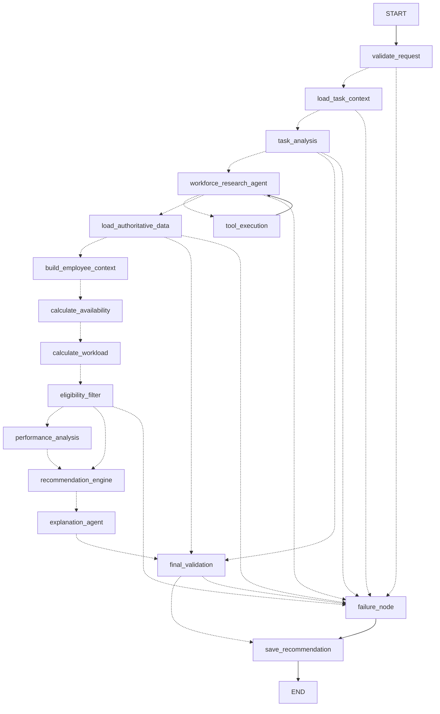

# Agent implementation report — SprintMatch AI

_Date: 2026-11-03 · LangGraph 1.2.19 · langchain-core 1.7.4 · langgraph-checkpoint-postgres 3.2.0_

Status legend: **E2E** = executed end to end in tests against PostgreSQL · **LIVE** = executed against a real LLM
provider (Groq, `openai/gpt-oss-120b`, OpenAI-compatible API).

## 1. Graph structure

One compiled `StateGraph(SprintMatchAgentState, context_schema=AgentContext)` named `sprintmatch_agent`
(`app/agents/builder.py`). 16 nodes (15 traced function nodes + the official `ToolNode`), node `RetryPolicy`
for retryable errors, optional checkpointer. Diagram (LangGraph renderer): [`docs/agent_graph.mmd`](docs/agent_graph.mmd).



## 2. Node inventory

| Node | Module | Responsibility |
|---|---|---|
| validate_request | `nodes/request.py` | schema, single task reference, `as_of` offset, tenant, window, DB ping |
| load_task_context | `nodes/request.py` | task, project/sprint, dependencies (open ones -> warning), execution window |
| task_analysis | `nodes/request.py` | requirements; manager > LLM (validated, grounded, injection-filtered) > defaults |
| workforce_research_agent | `nodes/research.py` | LLM with 20 tools bound; bounded loop; grounded, advisory summary |
| tool_execution | `tools/__init__.py` | LangGraph `ToolNode` + `ToolCallPolicy` (`wrap_tool_call` / `awrap_tool_call`) |
| load_authoritative_data | `nodes/data.py` | candidates and workforce records from PostgreSQL, independent of the LLM |
| build_employee_context | `nodes/data.py` | normalized Employee 360 summaries |
| calculate_availability | `nodes/data.py` | deterministic availability over the full window |
| calculate_workload | `nodes/data.py` | remaining commitments, unknown estimates, overcommitment |
| eligibility_filter | `nodes/evaluation.py` | hard constraints incl. required certifications |
| performance_analysis | `nodes/evaluation.py` | quality/reliability/similar-task evidence with sample counts |
| recommendation_engine | `nodes/evaluation.py` | official deterministic ranking (`sprintmatch-scoring-1.1.0`) |
| explanation_agent | `nodes/finalize.py` | LLM explanation of validated results (grounding check) or deterministic |
| final_validation | `nodes/finalize.py` | invariants; employee exists; eligible; **score recomputed = stored**; evidence; availability; mandatory constraints; one primary; explanation grounded |
| failure_node | `nodes/finalize.py` | standardized FAILED result with categorized errors |
| save_recommendation | `nodes/finalize.py` | upsert run + candidates + components + node logs + tool executions + errors + audit |

## 3–4. Edges and conditional routing

`app/agents/routing.py` (pure functions, unit-tested in `tests/agent/test_nodes.py::test_routing_functions`).
Every pipeline node can route to `failure_node` when `execution_status == FAILED`; `task_analysis` routes
NEEDS_INPUT / PROVIDER_UNAVAILABLE to `final_validation`; `workforce_research_agent` routes to `tool_execution` while
the last AIMessage has tool calls and the research is in progress, otherwise to `load_authoritative_data`;
`tool_execution` always returns to the agent; `load_authoritative_data` routes "no employees" to
`final_validation`; `eligibility_filter` skips performance when nobody is eligible; `final_validation` routes
invalid results to `failure_node`. Step bound: `recursion_limit = 30 + 2 × AGENT_MAX_TOOL_ROUNDS`.

## 5. Tool inventory (all read-only, PostgreSQL-backed)

| Group | Tools |
|---|---|
| A Employees | `search_employees`, `get_employee_profile`, `get_employee_skills`, `get_employee_experience`, `get_employee_performance` |
| B Workforce | `get_employee_attendance`, `get_employee_leave`, `get_employee_schedule`, `get_employee_assignments`, `calculate_employee_workload`, `calculate_employee_capacity`, `get_employee_availability` |
| C Tasks | `get_task_details`, `get_task_required_skills`, `search_similar_tasks` |
| D Recommendation | `evaluate_employee_eligibility`, `get_candidate_score`, `rank_task_candidates` |
| E Evidence | `get_recommendation_evidence`, `explain_exclusion_reason` |

Each tool: LangChain `@tool` with typed, documented arguments (the injected `ToolRuntime` is invisible to the
model); strict output schema (`app/schemas/agent_tools.py`); `AgentQueryService` -> repositories / deterministic
engines (no duplicated formulas); its own **READ ONLY** transaction with a PostgreSQL `statement_timeout`;
size-bounded JSON; structured, redacted errors. Policy: unknown tool, malformed/extra/invalid arguments, role,
duplicate detection (cached result), call budget (20), distinct-employee expansion limit (10), wall-clock timeout
(10 s), sanitized record + log line. No SQL, shell, write, assignment or permission tool exists
(`tests/unit/test_security_and_tools.py::test_tool_set_is_closed_and_read_only`).

## 6. Tool execution test results

`tests/tools/test_agent_tools.py` — **29 passed**. Every tool executed through the real `ToolNode` against the
seeded database with a valid call and asserted data (e.g. `get_candidate_score(EMP-001)` = 85.5, identical to the
official recommendation), plus invalid, missing-employee, missing-task, empty-result, database-error, timeout,
unknown-tool, malformed/extra arguments, duplicate, budget, expansion-limit, size-bounding, read-only-session,
logging and async-ToolNode cases. The module asserts that every registered tool has an executed test.

## 7. LLM provider compatibility

| Provider | Native tool calling | Structured output | Verified |
|---|---|---|---|
| OpenAI-compatible (`openai_compatible`) | yes (`tools`, probed once per process) | `json_schema` / `json_object` | mocked HTTP + **LIVE** (Groq `openai/gpt-oss-120b`: probe -> native) |
| Ollama (`ollama`) | from `/api/show` capabilities | `format` JSON schema | mocked HTTP only (no Ollama server here) |
| Models without tool calling | JSON tool plan (`json_plan`, allowlisted) | required | mocked (`test_json_plan_mode_*`) |
| None / unsuitable | research disabled; deterministic pipeline | — | tested |

Capabilities, model metadata and token usage are recorded per run (`llm_usage`, per-node tokens). HTTP 429
`Retry-After` is honored (bounded by `LLM_MAX_RETRY_WAIT_SECONDS`).

## 8. Checkpointing

`app/agents/checkpointer.py`: `PostgresSaver` (sync) and `AsyncPostgresSaver` (FastAPI) on psycopg pools, schema
`agent_checkpoints` (migration) with tables from the official `setup()` (`scripts.init_db`, app startup);
`InMemorySaver` for tests. Thread id = recommendation id. State is JSON-only with no full employee records
(asserted in `test_postgres_checkpoints_are_minimal_inspectable_and_pruned`). Durability `sync`. Recovery: a
retryable failure stops the run at the failing node; `resume` continues from the checkpoint and updates the same
run (`test_postgres_checkpoint_recovery_resumes_the_failed_node`: earlier nodes not re-executed, one DB row).
Inspection: `GET /agent/runs/{id}/checkpoints`. Retention: `CHECKPOINT_RETENTION_DAYS`, `scripts.prune_checkpoints`.
Windows: uvicorn `--loop app.core.event_loop:selector_loop_factory` (verified live).

## 9. Error handling

Standard categories (`app/core/exceptions.py`): VALIDATION_ERROR, DATABASE_ERROR, LLM_PROVIDER_ERROR,
TOOL_EXECUTION_ERROR, GRAPH_EXECUTION_ERROR, INCOMPLETE_DATA, NO_SUITABLE_CANDIDATE, PROVIDER_UNAVAILABLE, TIMEOUT,
INTERNAL_ERROR. Every error carries code, category, safe message, node, retryable; responses carry request id and
run id; FAILED runs are persisted with `error_category` (DB constraint) and never as success.

## 10. Invocation examples

```python
svc = RecommendationService(container)                       # app/application/recommendations.py
svc.create(ctx, RecommendationRequest(task_code="TASK-SCN-01"))   # graph.invoke
await svc.acreate(ctx, request, idempotency_key="k1")          # graph.ainvoke (FastAPI)
for event in svc.stream(ctx, request): ...                     # graph.stream
async for event in svc.astream(ctx, request): ...              # graph.astream (SSE endpoint)
svc.resume(ctx, run_id)                                        # continue from checkpoint
```

```bash
curl -X POST localhost:8000/api/v1/agent/recommend -H "X-API-Key: dev-manager-key" \
     -H "Content-Type: application/json" -d '{"task_code": "TASK-SCN-01"}'
uv run python -m scripts.run_agent_demo TASK-SCN-01 --stream
```

## 11. Test and end-to-end results (2026-11-03, this machine)

```
uv run pytest                      -> 180 passed, 2 skipped (live, opt-in)
  unit 85 · integration 14 · tools 29 · agent 37 (scenarios 16, graph 15, nodes 6) · api 15
RUN_LIVE_LLM_TESTS=1 pytest tests/live -m live   -> 2 passed (Groq)
uv run ruff check . / mypy app scripts           -> clean (130 files)
scripts.validate_demo_data                       -> 27/27 checks
```

Required graph tests: compile ✔, invoke ✔, ainvoke ✔, stream ✔, astream ✔, tool routing ✔, real ToolNode ✔,
results returned to agent ✔, multiple tool calls ✔, conditional routing ✔, bounded loops ✔, retry (RetryPolicy)
✔, failure paths ✔, no-eligible path ✔, deterministic fallback ✔, final recommendation ✔, persistence ✔,
checkpoint recovery ✔. The sequence *LLM tool call -> routing -> ToolNode -> PostgreSQL tool result -> agent
receives result -> graph continues -> recommendation* is asserted in
`test_tool_calls_route_execute_return_and_recommendation_is_generated`.

End-to-end scenarios (prompt §21 E): 1 available ✔ · 2 overloaded ✔ · 3 absent in window ✔ · 4 absent today,
available later ✔ · 5 missing skill ✔ · 6 no candidate ✔ · 7 LLM unavailable -> deterministic ✔ · 8 multiple
tools ✔ · 9 unknown tool rejected and logged ✔ · 10 availability change -> revalidation ✔ · 11 close scores,
deterministic tie-break ✔ · 12 incomplete history, no fabricated score ✔; plus required certification ✔.

**LIVE runs (Groq):** `scripts.test_llm_connection` (health, probe -> native, structured output, tool call
`get_employee_skills(EMP-001)`); `scripts.run_agent_demo` (3 tool rounds: `get_employee_skills`,
`search_employees`; LLM explanation accepted by grounding; EMP-001 85.5 = deterministic); uvicorn with
`AsyncPostgresSaver` + Groq: `POST /api/v1/agent/recommend` TASK-SCN-03 -> `search_employees`,
`rank_task_candidates`, `get_employee_profile(EMP-011)`, result EMP-011 84.68 vs EMP-012 84.6 (CLOSE_CANDIDATES).

## 12. Remaining limitations

* Groq free tier (8k tokens/min) limits research depth: earlier runs hit HTTP 429 and degraded to the deterministic
  path (by design); with `AGENT_MAX_TOOL_ROUNDS=3`, smaller tool results and Retry-After handling runs completed.
* Ollama adapter verified with mocked HTTP only; Docker Compose not executed (Docker unavailable here).
* The research summary is advisory text for the manager; it is grounded on employee codes, not sentence-level facts.
* Duplicate-call detection after a resume in a new process relies on checkpointed tool messages (rebuilt cache).
* The rate limiter is in-memory (per process).
