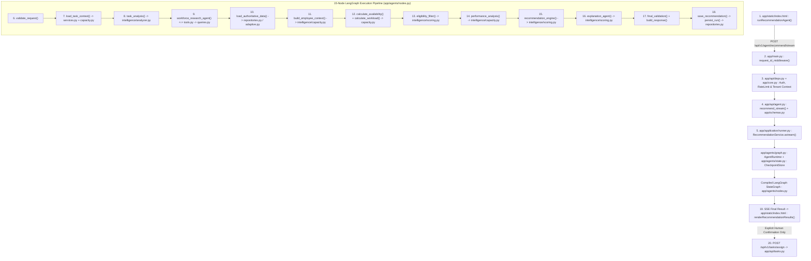

# SprintMatch AI — End-to-End Request Lifecycle & Execution Trace
### *Chronological file-by-file, function-by-function architectural walkthrough from task submission to persisted recommendation and human-confirmed assignment*

> [!IMPORTANT]
> **Document Scope:**
> This document traces a live recommendation request chronologically through every module, class, and function in the SprintMatch AI runtime. Each stage pairs a concise **Architectural Summary** with a detailed **Implementation Walkthrough** covering inputs, deterministic formulas, safety guardrails, SSE telemetry, and state transitions.

---

## End-to-End Execution Map

---

## Pre-Request Bootstrap: Application Startup Sequence

Before the first HTTP request arrives, starting the server via:
`uvicorn app.main:create_app --factory --loop app.core:selector_loop_factory`
initializes the entire runtime graph:

1. **[app/core.py](file:///c:/extra-addons17/scram%20agent/app/core.py#L138)** (`selector_loop_factory`): Initializes an `asyncio.SelectorEventLoop` on Windows so `psycopg`'s async connection pool (used by LangGraph's `AsyncPostgresSaver`) operates cleanly.
2. **[app/main.py](file:///c:/extra-addons17/scram%20agent/app/main.py#L69)** (`create_app`):
   - Loads validated environment configuration via `get_settings()` and registers all secret values (`register_secrets`) so credentials and API keys are automatically redacted from structured logs.
   - Creates the SQLAlchemy connection pool via `create_db_engine()` in [app/infrastructure/orm.py](file:///c:/extra-addons17/scram%20agent/app/infrastructure/orm.py#L66) and initializes the configured LLM client via `build_llm_provider()` in [app/infrastructure/llm.py](file:///c:/extra-addons17/scram%20agent/app/infrastructure/llm.py#L1072).
   - Calls `resolve()` in [app/infrastructure/adaptive.py](file:///c:/extra-addons17/scram%20agent/app/infrastructure/adaptive.py#L2320) to inspect the connected database (`looks_like_native_schema`):
     - If the application's native tables are present, it wires `SqlAlchemyUnitOfWorkFactory` from [app/infrastructure/repositories.py](file:///c:/extra-addons17/scram%20agent/app/infrastructure/repositories.py) (`native` mode).
     - If an external SQL schema is detected (e.g., Odoo or a custom HR/ERP database), it invokes `SchemaDiscovery.discover()` in [app/infrastructure/discovery.py](file:///c:/extra-addons17/scram%20agent/app/infrastructure/discovery.py#L728), caches the validated mapping in `schema_mapping.json`, and wires the read-only `AdaptiveUnitOfWorkFactory` (`adaptive` mode).
   - Composes the dependency root `AppContainer` in [app/application/services.py](file:///c:/extra-addons17/scram%20agent/app/application/services.py#L419) and attaches `AgentRuntime` ([app/agents/graph.py](file:///c:/extra-addons17/scram%20agent/app/agents/graph.py#L201)) backed by `CheckpointStore` ([app/agents/state.py](file:///c:/extra-addons17/scram%20agent/app/agents/state.py#L306)), which prepares PostgreSQL checkpoint tables inside FastAPI's `lifespan` hook.

---

## Stage 1: Task Submission & SSE Stream Initiation (Frontend)
- **Module:** [app/static/index.html](file:///c:/extra-addons17/scram%20agent/app/static/index.html#L3479-L3565)
- **Entry Function:** `async function runRecommendationAgent()` (Line `3479`)

> **Architectural Summary:**
> When a manager submits a task, the UI packages the task specification with `auto_complete: true` so missing fields can be inferred transparently, and opens a streaming `POST /api/v1/agent/recommend/stream` connection to render real-time agent reasoning progress over Server-Sent Events (SSE).

**Implementation Walkthrough:**
1. Collects form inputs (`taskTitleInput`, `taskDescInput`, `taskHoursInput`, `taskComplexityInput`, `taskPriorityInput`, `taskDeadlineInput`) and validates that at least a title or description is provided — all other attributes remain optional.
2. Constructs the JSON payload:
   - `task`: Includes user-provided values with `"auto_complete": true`.
   - `execution_window`: Defaults to `{"preset": "NEXT_WORKING_DAYS", "working_days": 5}`.
   - `as_of`: Current evaluation timestamp in ISO-8601 format with timezone offset.
3. Activates the live reasoning console (`startAgentThinkingAnimation()`), sends `fetch('/api/v1/agent/recommend/stream')` with the `X-API-Key` header, and incrementally decodes `data: {...}` frames via `streamRes.body.getReader()`.
4. Includes a resilient client fallback: if the SSE stream terminates before delivering the final `result` frame, the UI automatically falls back to the synchronous `POST /api/v1/recommendations` endpoint.

---

## Stage 2: Request Ingestion & Distributed Tracing Middleware
- **Module:** [app/main.py](file:///c:/extra-addons17/scram%20agent/app/main.py#L141-L153)
- **Function:** `request_id_middleware()` (Line `141`)

> **Architectural Summary:**
> Every inbound HTTP request passes through `request_id_middleware`, which binds a unique `X-Request-ID` to a thread-safe `ContextVar` so every downstream log line, tool execution record, and persisted audit entry can be correlated end to end.

**Implementation Walkthrough:**
- Accepts a sanitized caller-supplied `X-Request-ID` (length `<= 64`, safe ASCII charset `_REQUEST_ID_OK`) or generates a new `uuid.uuid4().hex`.
- Stores the ID in `request_id_var` (defined in `app/core.py`), attaches `X-Request-ID` to the outgoing HTTP response header, and resets the context token in a `finally` block.

---

## Stage 3: Authentication, Rate Limiting & Tenant Isolation
- **Modules:** [app/api/deps.py](file:///c:/extra-addons17/scram%20agent/app/api/deps.py#L34-L82) & [app/core.py](file:///c:/extra-addons17/scram%20agent/app/core.py#L350-L384)
- **Call Chain:** `get_principal()` ➔ `ApiKeyAuthenticator.authenticate()` ➔ `rate_limited()` ➔ `require_role(Role.MANAGER)` ➔ `_context()`

> **Architectural Summary:**
> Before entering the route handler, FastAPI dependencies enforce constant-time SHA-256 API-key authentication, per-client sliding-window rate limiting, role-based access control (`MANAGER` or `ADMIN`), and strict tenant scoping via an immutable `RequestContext`.

**Implementation Walkthrough:**
1. **`get_principal` (`deps.py` L39) ➔ `ApiKeyAuthenticator.authenticate()` (`core.py` L350):**
   - Plaintext keys are never stored in configuration. Incoming `X-API-Key` headers are hashed with `SHA-256` and compared via `hmac.compare_digest` to prevent timing attacks; invalid keys raise `AuthenticationError` (`401`).
   - In `development`/`test` environments with no keys configured, falls back to a local admin principal bound to company `NDS`.
2. **`rate_limited` (`deps.py` L67) ➔ `RateLimiter.check()` (`core.py` L367):**
   - Applies a thread-safe 60-second sliding window (`deque` + `threading.Lock`) capped at `rate_limit_per_minute` (default `30` requests/min); violations raise `RateLimitExceededError` (`429`).
3. **`Manager = Depends(require_role(Role.MANAGER))` (`deps.py` L79):**
   - Verifies `principal.role.rank >= Role.MANAGER.rank` (rejecting `VIEWER` callers with `403 AuthorizationError`).
   - Resolves the caller's `Company` record inside `_context()` (L46) and constructs `RequestContext(company, actor, role, request_id)` so all downstream queries remain strictly isolated to that tenant.

---

## Stage 4: Route Dispatch & Strict Payload Validation
- **Modules:** [app/api/agent.py](file:///c:/extra-addons17/scram%20agent/app/api/agent.py#L77-L98) & [app/schemas.py](file:///c:/extra-addons17/scram%20agent/app/schemas.py#L137-L195)
- **Entry Function:** `recommend_stream()` (Line `90`) — *(or `recommend()` at Line `77` for non-streaming calls)*

> **Architectural Summary:**
> FastAPI validates the request payload against strict Pydantic v2 contracts (`extra="forbid"`), ensuring an unambiguous task reference, then opens a `StreamingResponse` (`text/event-stream`) backed by `RecommendationService.astream()`.

**Implementation Walkthrough:**
1. **`RecommendationRequest` (`app/schemas.py` L173):** Enforces `ConfigDict(extra="forbid")` to reject unknown fields, and runs `_one_task_reference` to require exactly one of `task_id`, `task_code`, or an inline `task: TaskSpecification`.
2. **`TaskSpecification` (`app/schemas.py` L137):** Runs `_require_title_or_description` to ensure non-empty work context. Validation errors are caught globally in `app/main.py` (`handle_validation`) and returned as structured `422 INVALID_INPUT` responses.
3. **`recommend_stream()` (`app/api/agent.py` L90):** Iterates over `RecommendationService(container).astream(ctx, body)`, encoding each structured dictionary as an SSE frame (`data: <json>\n\n`) via `sse()`.

---

## Stage 5: Orchestration Setup, Mode Resolution & Checkpointing
- **Modules:** [app/application/runner.py](file:///c:/extra-addons17/scram%20agent/app/application/runner.py#L214-L505), [app/agents/graph.py](file:///c:/extra-addons17/scram%20agent/app/agents/graph.py#L201-L263), [app/agents/state.py](file:///c:/extra-addons17/scram%20agent/app/agents/state.py#L110-L380), [app/infrastructure/llm.py](file:///c:/extra-addons17/scram%20agent/app/infrastructure/llm.py#L59)
- **Function:** `RecommendationService.astream()` (Line `454`) — *(or `acreate()` at Line `407`)*

> **Architectural Summary:**
> `RecommendationService` serves as the single entry point into the compiled LangGraph `StateGraph`. It enforces idempotency replay, initializes the checkpointable graph state, resolves the LLM tool-calling mode (`NATIVE`, `JSON_PLAN`, or `DISABLED`), attaches a PostgreSQL checkpointer, and begins streaming node updates.

**Implementation Walkthrough:**
1. **Idempotency Replay (`_replay`, L246 on `/recommend`):** Checks `find_by_idempotency_key(company.id, key)`; if a matching run exists, immediately returns the stored snapshot (`200 OK`, `idempotent_replay=True`) without re-running the graph or incurring LLM token cost.
2. **Initial Graph State (`_initial_state`, L214):** Allocates a `run_id = uuid.uuid4()` (shared as `recommendation_id` and LangGraph `thread_id`), normalizes `as_of`, and initializes reducer-backed lists (`messages`, `trace`, `agent_tool_results`, `agent_warnings`, `errors`).
3. **Agent Mode & Context (`AgentRuntime.context()`, `graph.py` L231 ➔ `resolve_agent_mode()`, `state.py` L110):**
   - Probes provider capabilities once and caches the decision: `NATIVE` (native tool calling), `JSON_PLAN` (structured JSON tool-plan adapter for models without native tool calls), or `DISABLED` (pure deterministic execution when `LLM_PROVIDER=none`).
   - Instantiates a per-run `AgentContext` containing an in-memory `RunWorkspace` so bulky employee records stay out of PostgreSQL checkpoint payloads.
4. **Compiled Graph & Checkpointer (`AgentRuntime.async_graph()`, `graph.py` L259):**
   - Connects `AsyncPostgresSaver` (`CheckpointStore.async_saver()`, `state.py` L306) writing to the dedicated `agent_checkpoints` schema, with bounded `recursion_limit` (`2 * max_tool_rounds + 25`, default `35`).
5. **Stream Start & Token Metering:** Emits the initial `started` SSE event (`recommendation_id`, `agent_mode`, `adapter_kind`), opens `with metered():` (`llm.py` L59) to meter LLM calls and token usage, and invokes `graph.astream(..., stream_mode="updates")`.

---

## Stage 6 (Node 1): `validate_request`
- **Module:** [app/agents/nodes.py](file:///c:/extra-addons17/scram%20agent/app/agents/nodes.py#L283-L304)
- **Function:** `validate_request(state, ctx)` — decorated with `@traced("validate_request")` (Line `139`)

> **Architectural Summary:**
> Every node is wrapped in `@traced`, which captures execution latency, retry attempts, token usage, and structured telemetry. `validate_request` performs defensive runtime invariants (timezone presence, tenant match, valid window ordering) and verifies live database connectivity via `uow.ping()`.

**Implementation Walkthrough:**
1. Re-validates `state["request"]` against `RecommendationRequest`, confirms `as_of.tzinfo is not None`, enforces `state["company_id"] == str(ctx.request.company.id)`, and validates `deadline > start`.
2. Executes `with ctx.services() as s: s.uow.ping()` (`SELECT 1`). Transient database errors trigger LangGraph's bounded `RetryPolicy` (`agent_node_max_attempts=2`); persistent outages pause the run cleanly with `resumable=True` so `/runs/{run_id}/retry` can resume from the checkpoint once connectivity recovers.
3. **SSE Telemetry:** `_sse_events()` in `app/application/runner.py` emits `{"event": "node", "node": "validate_request", "status": "ok", "duration_ms": ...}`.
4. **Conditional Edge (`after_validate`, [app/agents/graph.py](file:///c:/extra-addons17/scram%20agent/app/agents/graph.py#L61)):** Routes `FAILED` to `failure_node`, otherwise transitions to **`load_task_context`**.

---

## Stage 7 (Node 2): `load_task_context`
- **Module:** [app/agents/nodes.py](file:///c:/extra-addons17/scram%20agent/app/agents/nodes.py#L307-L343)
- **Delegates to:** `TaskService` & `WorkforceService` ([app/application/services.py](file:///c:/extra-addons17/scram%20agent/app/application/services.py#L212-L335)) ➔ `resolve_window()` ([app/intelligence/capacity.py](file:///c:/extra-addons17/scram%20agent/app/intelligence/capacity.py#L266-L320))

> **Architectural Summary:**
> Resolves the task input from either an existing database record (including open dependency checks) or an inline payload, and computes the exact timezone-aware `ExecutionWindow` while skipping company weekends and public holidays.

**Implementation Walkthrough:**
1. For inline tasks (`req.task`), converts directly to `TaskInput` via `to_task_input()`. For stored tasks (`task_id`/`task_code`), loads the full `TaskRecord` (including `task_required_skills` and `task_dependencies`) and flags any unresolved prerequisite tasks via `OPEN_DEPENDENCIES:<codes>`.
2. Queries company holidays (`uow.workforce.get_holidays()`) and delegates to **`resolve_window()` (`app/intelligence/capacity.py` L266)**, which steps forward through `next_working_days()` respecting the company's timezone and working-day calendar (e.g., Sunday–Thursday in `Africa/Cairo`) to produce `ExecutionWindow(start, end)`.
3. Commits `task_record`, `task_input`, and `execution_window` to graph state, emits SSE progress metadata, and routes via `after_load_task` to **`task_analysis`**.

---

## Stage 8 (Node 3): `task_analysis` — Adaptive Requirement Extraction & Injection Defense
- **Module:** [app/agents/nodes.py](file:///c:/extra-addons17/scram%20agent/app/agents/nodes.py#L346-L364)
- **Delegates to:** `TaskService.analyze()` ➔ `TaskAnalyzer.analyze()` ([app/intelligence/analyzer.py](file:///c:/extra-addons17/scram%20agent/app/intelligence/analyzer.py#L988-L1260)) & optionally `LLMProvider` ([app/infrastructure/llm.py](file:///c:/extra-addons17/scram%20agent/app/infrastructure/llm.py))

> **Architectural Summary:**
> Transforms raw or partial task descriptions into catalog-grounded `TaskRequirements` using a strict precedence hierarchy — **Manager Input ➔ Validated LLM Suggestion ➔ Bilingual Heuristics & Local Semantic Embeddings** — after isolating potential prompt-injection text.

**Implementation Walkthrough (`app/intelligence/analyzer.py`):**
1. **Prompt-Injection Isolation (`split_instruction_like`, L112):** Scans sentences for directive/override patterns (English and Arabic). Flagged segments are stripped from `clean_text` and recorded with warning `POSSIBLE_PROMPT_INJECTION` so untrusted text cannot hijack extraction.
2. **Catalog Grounding (`SkillCatalogIndex`, L938):** Indexes the tenant's actual `skills` table with aliases, Arabic/English normalization (`strip_al`, `normalize_arabic`, `variants`), and conservative typo matching (`fuzzy_equals`). No requirement can reference a non-existent skill.
3. **6-Tier Skill Resolution Cascade:**
   - **Tier 1 (Explicit Manager Skills):** Direct resolution against catalog (confidence `1.0`).
   - **Tier 2 (Catalog-Validated LLM Output):** If fields are missing and an LLM is configured, sends `<task>`-delimited text and catalog names for `LLMTaskAnalysisOutput`. Unrecognized skills are rejected; if injection was flagged, suggestions must appear verbatim in `clean_text`.
   - **Tier 3 (Bilingual Keyword & Hint Matching):** `_skills_from_text` matches exact names, aliases, and domain hints across English and Arabic.
   - **Tier 4 (Local Multilingual Semantic Search):** `_skills_from_semantic_search` queries `SemanticSkillMatcher` (`paraphrase-multilingual-MiniLM-L12-v2`, with `FallbackConceptVectorMatcher` offline fallback) to infer skills from conceptual descriptions.
   - **Tiers 5 & 6 (Domain Context & Catalog Token Match):** Used when `auto_complete=True` for sparse inputs.
4. **Adaptive Field Completion:** Missing attributes (`title`, `complexity`, `priority`, `task_category`, `estimated_hours`) are inferred with explicit provenance recorded in `inferred_fields` (`source: "llm" | "heuristic"`). When critical requirements remain unresolvable without `auto_complete`, returns `NEEDS_INPUT` rather than guessing.
5. **SSE Telemetry & Routing (`after_analysis`, `graph.py` L70):** Streams extracted skills and `inferred_fields` to the UI. `READY` proceeds to **`workforce_research_agent`**; `NEEDS_INPUT` or `PROVIDER_UNAVAILABLE` short-circuits cleanly to **`final_validation`**.

---

## Stage 9 (Node 4 + ToolNode): Bounded Workforce Research Loop (20 Read-Only Tools)
- **Modules:** `workforce_research_agent()` ([app/agents/nodes.py](file:///c:/extra-addons17/scram%20agent/app/agents/nodes.py#L499-L564)) ⇄ `ToolCallPolicy` & 20 Tools ([app/agents/tools.py](file:///c:/extra-addons17/scram%20agent/app/agents/tools.py#L234-L770)) ➔ `AgentQueryService` ([app/application/queries.py](file:///c:/extra-addons17/scram%20agent/app/application/queries.py))

> **Architectural Summary:**
> Runs an optional, strictly bounded ReAct research loop over 20 read-only database tools guarded by a 7-step `ToolCallPolicy` to gather advisory context for the manager. Output is strictly grounded against observed tool responses, never alters deterministic scores, and gracefully degrades if the LLM provider is unavailable.

**Implementation Walkthrough:**
1. **Graceful Bypass:** If `agent_mode == DISABLED` or an `LLMError` occurs, the node records status/warning and proceeds directly to deterministic evaluation without failing the request.
2. **Bounded ReAct Loop (`after_research`, `graph.py` L79):** The model invokes tools from 4 read-only families (`EMPLOYEE_TOOLS [5]`, `TASK_TOOLS [3]`, `WORKFORCE_TOOLS [7]`, `RECOMMENDATION_TOOLS [5]`), capped at `max_tool_rounds=5`, `max_tool_calls=20`, and `max_profile_expansions=10`.
3. **7-Gate `ToolCallPolicy` (`app/agents/tools.py` L234):** Every tool call passes seven checks before touching the database:
   1. **Allowlist Check:** Rejects any unapproved tool name (`UNKNOWN_TOOL`).
   2. **Strict Schema Validation:** Validates JSON arguments against the tool's Pydantic schema and rejects unexpected keys (`INVALID_TOOL_ARGUMENTS`).
   3. **RBAC Check:** Enforces minimum `Role` requirements (`FORBIDDEN`).
   4. **Duplicate Deduplication Cache:** Computes `call_signature(name, args)` in `RunWorkspace.claim`; repeated identical calls return cached results (`DUPLICATE`) without hitting the database or consuming budget.
   5. **Budget Enforcement:** Caps distinct employee inspections (`10`) and total tool executions (`20`).
   6. **Isolated Read-Only Execution (`run_query`, L104):** Executes against `AgentQueryService` using `read_only=True`, a database statement timeout, a 10-second `ThreadPoolExecutor` wall-clock timeout, and strict response truncation (`<= 12,000` chars, `<= 25` items).
   7. **Audit & SSE Emission:** Appends a sanitized `ToolExecutionRecord` and emits an immediate SSE `tool` event to the UI.
4. **Anti-Hallucination Grounding (`_ground()`, `nodes.py` L432):** Once the model produces its final `WorkforceResearchSummary`, any `employee_code` not present in actual tool outputs (`_seen_employee_codes`) is stripped automatically with a warning.

---

## Stage 10 (Node 5): `load_authoritative_data` — Authoritative Ingestion Boundary
- **Module:** [app/agents/nodes.py](file:///c:/extra-addons17/scram%20agent/app/agents/nodes.py#L570-L585)
- **Delegates to:** `RecommendationPipeline` ([app/application/services.py](file:///c:/extra-addons17/scram%20agent/app/application/services.py#L470)) ➔ [app/infrastructure/repositories.py](file:///c:/extra-addons17/scram%20agent/app/infrastructure/repositories.py) (`native`) or [app/infrastructure/adaptive.py](file:///c:/extra-addons17/scram%20agent/app/infrastructure/adaptive.py) (`adaptive`)

> **Architectural Summary:**
> Marks the hard architectural boundary between advisory LLM reasoning and authoritative deterministic scoring: all active employees, skill profiles, schedules, leaves, and active commitments are batch-loaded directly from the database into the in-memory `RunWorkspace`.

**Implementation Walkthrough:**
1. Loads all active tenant employee IDs (`p.employee_ids()`). If zero active employees exist, sets `NO_SUITABLE_CANDIDATE` and routes directly to `final_validation`.
2. Batch-fetches `EmployeeProfile` records (`p.profiles(ids)`) and workforce datasets + company holidays (`p.workforce(ids, window, as_of)`) without N+1 query overhead, storing the full objects in `ctx.workspace`.
3. Persists only lightweight `employee_ids` in the checkpointed `State` and streams `total_employees` over SSE.

---

## Stage 11 (Node 6): `build_employee_context` — Effective Skill Assessment
- **Module:** [app/agents/nodes.py](file:///c:/extra-addons17/scram%20agent/app/agents/nodes.py#L588-L615)
- **Delegates to:** `RecommendationEngine.assess_skills()` ➔ `assess_skill()` ([app/intelligence/capacity.py](file:///c:/extra-addons17/scram%20agent/app/intelligence/capacity.py#L50-L71))

> **Architectural Summary:**
> Normalizes every employee's declared skills into effective proficiency scores by applying verification-status and assessment-recency discounts defined in `SkillPolicy` (`app/domain.py`).

**Implementation Walkthrough:**
- Computes each skill's effective level via:

$$\text{effective\_level} = \text{proficiency\_level} \times \text{verification\_factor} \times \text{recency\_factor}$$

  - **Verification factors (`SkillPolicy`):** `VERIFIED = 1.0`, `PENDING_REVIEW = 0.9`, `SELF_DECLARED = 0.8`, `REJECTED = 0.0`.
  - **Staleness decay:** `< 24` months = `1.0`, `24–35` months = `0.85` (`stale=True`), `>= 36` months = `0.70` (`stale=True`).
- Stores compact required-skill summaries in `state["employee_profiles"]`.

---

## Stage 12 (Nodes 7 & 8): `calculate_availability` & `calculate_workload`
- **Module:** [app/agents/nodes.py](file:///c:/extra-addons17/scram%20agent/app/agents/nodes.py#L618-L655)
- **Delegates to:** `WorkforceCalculator.calculate()`, `build_work_blocks()`, and `resolve_remaining_effort()` ([app/intelligence/capacity.py](file:///c:/extra-addons17/scram%20agent/app/intelligence/capacity.py#L189-L480))

> **Architectural Summary:**
> Computes net free working capacity inside the target execution window using timezone-aware shift algebra — deducting prorated breaks, public holidays, approved leave, and prorated remaining effort on active assignments without double-counting historical timesheets.

**Implementation Walkthrough (`app/intelligence/capacity.py`):**
1. **Working Time Algebra (`build_work_blocks`, L189 & `merge_intervals`, L221):**
   - Intersects each employee's weekly schedule (in their personal timezone) with the execution window, prorating shift breaks for partial-day overlaps.
   - Merges overlapping leave intervals to prevent double deduction; deducts `APPROVED` leave and company holidays (`available_working_hours = scheduled - holiday_hours - leave_hours`), while `REQUESTED` (unapproved) leave emits `PENDING_LEAVE_IN_WINDOW` without deducting hours.
2. **Remaining Effort Precedence (`resolve_remaining_effort`, L332):**
   1. Explicit `assignment.remaining_estimated_hours` ➔ `CERTAIN`.
   2. `task.remaining_estimated_hours` (sole active assignee only) ➔ `CERTAIN`.
   3. `max(allocated_hours - logged_hours, 0)` (the *only* place historical timesheets are used) ➔ `ESTIMATED`.
   4. Unestimated or unsplit multi-assignee work ➔ `UNKNOWN` (`UNCERTAIN` — never guessed; emits `MISSING_WORKLOAD_ESTIMATES`).
3. **Net Free Capacity & Classification:**
   - `available_capacity_hours = max(0, available_working_hours - committed_work_hours - other_commitment_hours)`.
   - Classifies each employee as `AVAILABLE`, `PARTIALLY_AVAILABLE`, `BUSY`, `ON_LEAVE`, `UNAVAILABLE`, or `UNKNOWN`. `calculate_workload` summarizes overcommitted staff and emits SSE capacity counts.

---

## Stage 13 (Node 9): `eligibility_filter` — Hard Constraint Gates
- **Module:** [app/agents/nodes.py](file:///c:/extra-addons17/scram%20agent/app/agents/nodes.py#L661-L667)
- **Delegates to:** `evaluate_eligibility()` ([app/intelligence/scoring.py](file:///c:/extra-addons17/scram%20agent/app/intelligence/scoring.py#L50-L228))

> **Architectural Summary:**
> Evaluates six non-negotiable business constraints independently before soft ranking. Disqualified employees receive structured exclusion records (`ExclusionDetail`), and if zero candidates pass, the graph skips performance queries and routes directly to ranking for explicit `NO_SUITABLE_CANDIDATE` reporting.

**Implementation Walkthrough (6 Hard Gates):**
1. **Employment Status:** Non-`ACTIVE` employees are excluded (`EMPLOYEE_INACTIVE`).
2. **Mandatory Skills:** Missing skills (`MANDATORY_SKILL_MISSING`), effective level below threshold (`MANDATORY_SKILL_BELOW_THRESHOLD`), or missing required verification (`MANDATORY_SKILL_NOT_VERIFIED`). When all skills are optional, at least one must meet its minimum threshold (`NO_REQUIRED_SKILL_COVERAGE`).
3. **Access Controls:** Enforces `restricted_to_team_id` (`TEAM_ACCESS_REQUIRED`) and `requires_project_membership` (`PROJECT_ACCESS_REQUIRED`).
4. **Certifications:** Verifies required credentials are held, not rejected, and unexpired as of `as_of` (`REQUIRED_CERTIFICATION_MISSING`).
5. **Availability Status:** Excludes employees fully on leave (`ON_LEAVE_DURING_WINDOW`), with zero working time (`NO_WORKING_TIME_IN_WINDOW`), `BUSY`, or with unknown schedule/capacity (`AVAILABILITY_UNKNOWN`, tagged `is_data_gap=True`).
6. **Capacity Sufficiency:** Requires `available_capacity_hours >= estimated_hours * capacity_buffer` (`INSUFFICIENT_AVAILABLE_CAPACITY`). Existing assignments never disqualify an employee as long as remaining capacity suffices.
- **SSE & Conditional Routing (`after_eligibility`, [app/agents/graph.py](file:///c:/extra-addons17/scram%20agent/app/agents/graph.py#L109)):** Streams eligible/excluded counts and top exclusion codes. Routes to **`performance_analysis`** if `>= 1` candidate is eligible, else short-circuits directly to **`recommendation_engine`**.

---

## Stage 14 (Node 10): `performance_analysis` — Historical Metrics & Bayesian Shrinkage
- **Module:** [app/agents/nodes.py](file:///c:/extra-addons17/scram%20agent/app/agents/nodes.py#L670-L693)
- **Delegates to:** `PerformanceRepository` ➔ `summarize_performance()` & `shrink()` ([app/intelligence/capacity.py](file:///c:/extra-addons17/scram%20agent/app/intelligence/capacity.py#L77-L160))

> **Architectural Summary:**
> Aggregates historical task quality and on-time delivery reliability for eligible candidates, up-weighting similar past tasks (`2x`), excluding externally caused delays, and applying Bayesian shrinkage so small sample sizes neither unfairly penalize nor inflate new hires.

**Implementation Walkthrough (`app/intelligence/capacity.py`):**
1. **Task Similarity (`task_similarity`, L77):** Measures overlap against the target task (`70%` skill Jaccard overlap + `30%` category match); outcomes with similarity `>= 0.5` receive `2.0x` quality weight.
2. **Quality Adjustment (`outcome_quality`, L92):** Deducts `rework_count * 10.0` from reviewed quality and caps rejected deliverables at `40.0`.
3. **Fair Delay Attribution:** Delays with non-attributable `DelayReason` values (`EXTERNAL_DEPENDENCY`, `SCOPE_CHANGE`, `UNPLANNED_LEAVE`, `ENVIRONMENT_ISSUE`) are tracked as `excused_delays` and excluded from `on_time_rate`.

---

## Stage 15 (Node 11): `recommendation_engine` — 7-Criterion Weighted Scoring & Deterministic Ranking
- **Module:** [app/agents/nodes.py](file:///c:/extra-addons17/scram%20agent/app/agents/nodes.py#L696-L719)
- **Delegates to:** `RecommendationEngine` ([app/intelligence/scoring.py](file:///c:/extra-addons17/scram%20agent/app/intelligence/scoring.py#L261-L745)) & `ScoringConfig` ([app/domain.py](file:///c:/extra-addons17/scram%20agent/app/domain.py))

> **Architectural Summary:**
> Evaluates every candidate across 7 weighted criteria totaling `100%`, dynamically re-normalizes weights when a criterion is non-applicable, computes evidence-weighted confidence, and sorts eligible candidates using a 4-key deterministic tie-breaker.

**Implementation Walkthrough (`app/intelligence/scoring.py`):**
1. **7 Weighted Criteria (`score_candidate`, L581):**
   - **`SKILL_MATCH` (`30%`):** Exact minimum match scores `85`; surplus proficiency scales smoothly to `100`.
   - **`EXPERIENCE` (`15%`):** `60%` completed similar tasks (full score at `5`) + `40%` merged non-overlapping relevant years (full score at `5` years); neutral prior `50` when unrecorded.
   - **`QUALITY` (`15%`):** Bayesian-shrunk quality mean (`prior=60.0`, pseudo-count `k=3`):
     $$\text{Adjusted Score} = \frac{n \cdot \bar{x} + 3 \cdot \mu_0}{n + 3}$$
   - **`RELIABILITY` (`10%`):** Bayesian-shrunk attributable on-time delivery rate (`prior=0.70`, `k=3`).
   - **`CAPACITY` (`15%`):** `1.0x` coverage scores `50`, scaling linearly to `100` at `2.0x` capacity headroom.
   - **`COMPLEXITY_FIT` (`10%`):** Matches task complexity (`1..4`) against seniority tier (`2/5/8` yrs) or highest successfully delivered complexity (`quality >= 70`). Under-qualification deducts `35` pts/level; over-qualification by `>= 2` levels scores `85` to preserve senior engineers for critical work.
   - **`PROJECT_FAMILIARITY` (`5%`):** Scores prior completed tasks and membership on the target project (`0/25/50/75/100`). When `project_id` is absent, marked `applicable=False` and `_apply_weights()` (L698) proportionally re-normalizes the remaining `95%` to `1.000000`.
2. **Confidence & Coverage:** `confidence = data_coverage * certainty_factor` (`CERTAIN=1.0`, `ESTIMATED=0.85`, `UNCERTAIN=0.60`), classified into `HIGH` (`>= 0.80`), `MEDIUM` (`>= 0.55`), or `LOW`.
3. **Deterministic Ranking & Edge Cases (`rank`, L628):**
   - Sorted strictly by `(-suitability_score, -data_coverage, -available_capacity_hours, employee_code)`.
   - Flags `CLOSE_CANDIDATES` when top-two scores differ by `<= 2.0`.
   - When `0` candidates are eligible, returns `NO_SUITABLE_CANDIDATE`, checks `DEADLINE_INFEASIBLE`, and surfaces the strongest near-miss via `NEAREST_MATCH_INSIGHT` with the exact blocking gap.
   - Records `ScoringConfig.fingerprint()` (16-char SHA-256 hash) for full historical auditability and streams `top_candidate` & `runner_up` over SSE.

---

## Stage 16 (Node 12): `explanation_agent` — Evidence-Grounded Comparative Rationale
- **Module:** [app/agents/nodes.py](file:///c:/extra-addons17/scram%20agent/app/agents/nodes.py#L732-L740)
- **Delegates to:** `generate_explanation()` & `deterministic_explanation()` ([app/intelligence/scoring.py](file:///c:/extra-addons17/scram%20agent/app/intelligence/scoring.py#L943-L1145))

> **Architectural Summary:**
> Generates a concise comparative rationale (in Arabic or English matching the task language) explaining why the primary candidate outperformed the runner-up — either deterministically or via an evidence-bound LLM rewrite.

**Implementation Walkthrough:**
- Detects task language via `is_arabic(requirements.title)` and contrasts top criterion advantages between Rank #1 and Rank #2 (`_runner_up_advantages`).
- Runs deterministically by default (`EXPLANATION_MODE=deterministic`). In `llm` mode, the model receives only verified numeric evidence and is validated by `is_grounded()` before acceptance.

---

## Stage 17 (Node 13): `final_validation` — Independent Post-Evaluation Audit
- **Module:** [app/agents/nodes.py](file:///c:/extra-addons17/scram%20agent/app/agents/nodes.py#L744-L860)
- **Delegates to:** `check_invariants()`, `_validate_primary()`, `build_response()` (`nodes.py` L1025) & `CandidateOut.from_evaluation()` ([app/schemas.py](file:///c:/extra-addons17/scram%20agent/app/schemas.py#L212))

> **Architectural Summary:**
> Acts as an independent final verifier before persistence: re-checks all mathematical invariants, re-queries and re-scores the primary candidate directly against the database (`tolerance <= 0.01`), validates numeric grounding of LLM explanations, and assembles the final `RecommendationResponse`.

**Implementation Walkthrough (8 Verification Checks):**
1. `engine_invariants`: Sequential ranks `1..N`, scores in `[0, 100]`, criterion weights summing to `1.0`, zero ranked excluded candidates.
2. `exactly_one_primary` & `candidate_eligible` & `required_evidence_present`.
3. `employee_exists`: Live database verification via `uow.employees.get_employee()`.
4. `score_matches_engine`: Independently re-runs `s.engine.score_candidate()` and asserts `abs(rescored - primary.score) <= 0.01`.
5. `mandatory_constraints_met` & `availability_sufficient`: Independently confirms mandatory skills and free hours.
6. `explanation_grounded`: Verifies every numeric claim in an LLM-authored explanation against evidence; any mismatch triggers silent fallback to the deterministic explanation (`LLM_EXPLANATION_REJECTED_AT_FINAL_VALIDATION`).
- Calls `build_response()` (`nodes.py` L1025) to serialize the complete `RecommendationResponse`. *(Upstream fatal errors instead route through Node 14 `failure_node`, L862, producing a standardized `FAILED` response with zero fabricated candidates).*

---

## Stage 18 (Node 15): `save_recommendation` — Atomic Persistence & Audit Trail
- **Module:** [app/agents/nodes.py](file:///c:/extra-addons17/scram%20agent/app/agents/nodes.py#L879-L1196) (`save_recommendation` ➔ `persist_run`)
- **Delegates to:** `SqlRecommendationRepository.save_run()` & `SqlAuditRepository.record()` ([app/infrastructure/repositories.py](file:///c:/extra-addons17/scram%20agent/app/infrastructure/repositories.py#L1000-L1295)) ➔ ORM Tables ([app/infrastructure/orm.py](file:///c:/extra-addons17/scram%20agent/app/infrastructure/orm.py#L695-L881))

> **Architectural Summary:**
> Atomically persists the complete recommendation run, candidate evaluations, per-criterion evidence, node trace, tool audit log, and audit event inside the application's internal database — guaranteeing zero writes to external databases in `adaptive` mode.

**Implementation Walkthrough:**
1. Calls `s.uow.recommendations.save_run(run, request)` and `s.uow.audit.record(...)` within a single transaction (`s.uow.commit()`).
2. **External Database Write Isolation (`AdaptiveUnitOfWork`, [app/infrastructure/adaptive.py](file:///c:/extra-addons17/scram%20agent/app/infrastructure/adaptive.py#L2061)):**
   - In `native` mode, writes directly to the application's PostgreSQL store.
   - In `adaptive` mode, business-data repositories (`employees`, `tasks`, `workforce`, `performance`) remain strictly read-only against the external database while `recommendations` and `audit` automatically delegate to `self._internal_factory` (the application's own store).
3. **Persisted Audit Tables (`app/infrastructure/orm.py`):**
   - `recommendation_runs` (run status, JSON snapshot, policy fingerprint, LLM token counts, execution latency)
   - `recommendation_candidates` (ranked and excluded candidates with exclusion reasons)
   - `recommendation_score_components` (all 7 criterion scores, normalized weights, and textual evidence)
   - `agent_execution_logs` (per-node execution status, attempts, and `duration_ms`)
   - `agent_tool_executions` (sanitized tool arguments, summary outputs, and timings)
   - `audit_events` (immutable `recommendation.generated` / `recommendation.failed` event)

---

## Stage 19: Final SSE Delivery & Interactive Rendering (Frontend)
- **Path:** `RecommendationService.astream()` ([app/application/runner.py](file:///c:/extra-addons17/scram%20agent/app/application/runner.py#L495)) ➔ `recommend_stream()` ([app/api/agent.py](file:///c:/extra-addons17/scram%20agent/app/api/agent.py#L90)) ➔ `renderRecommendationResults()` ([app/static/index.html](file:///c:/extra-addons17/scram%20agent/app/static/index.html#L3648))

> **Architectural Summary:**
> Upon persistence completion, `astream()` emits the terminal `result` SSE event carrying the full `RecommendationResponse` JSON, which the frontend renders into an interactive decision console with drill-down factor evidence and categorized exclusion filters.

**Implementation Walkthrough:**
1. Completes the live thinking console (`finishAgentThinkingAnimation(data)`).
2. Renders the Primary Candidate summary card (suitability score, confidence badge, available hours, comparative rationale).
3. Populates the interactive 7-factor evidence grid (`#factorCardsGrid`): selecting any factor opens its exact underlying evidence and weight via `showFactorEvidence()`.
4. Renders ranked alternatives for side-by-side comparison and categorized excluded candidates (`SKILLS`, `CAPACITY`, `LEAVE`, `OTHER`) with live search filtering.

---

## Stage 20 (Optional — Explicit Human Decision Only): Task Assignment Confirmation
- **Trigger:** Manager clicks **Confirm Assignment** (or selects an override via **Manual Assign**) in [app/static/index.html](file:///c:/extra-addons17/scram%20agent/app/static/index.html#L4188)
- **Endpoint:** `POST /api/v1/tasks/assign` ➔ `assign_task_to_employee()` in [app/api/tasks.py](file:///c:/extra-addons17/scram%20agent/app/api/tasks.py#L209)

> **Architectural Summary:**
> Enforcing the **Advisory-Only / Human-in-the-Loop** contract, no task assignment is mutated during recommendation execution. Only an explicit manager confirmation triggers a separate write request to `/api/v1/tasks/assign`, committing the assignment to `task_assignments` and updating future capacity calculations.

---

## End-to-End Execution Reference Table

| Step | Module | Function / Class | Primary Responsibility |
|---|---|---|---|
| **1** | `app/static/index.html` | `runRecommendationAgent()` | Packages task payload (`auto_complete: true`) and opens SSE stream to `/api/v1/agent/recommend/stream`. |
| **2** | `app/main.py` | `request_id_middleware()` | Assigns/propagates `X-Request-ID` across logs and HTTP headers. |
| **3** | `app/api/deps.py` + `app/core.py` | `ApiKeyAuthenticator` + `RateLimiter` + `_context()` | Enforces SHA-256 auth, sliding-window rate limits, RBAC, and tenant isolation. |
| **4** | `app/api/agent.py` + `app/schemas.py` | `recommend_stream()` + `RecommendationRequest` | Validates strict Pydantic v2 payload and initializes `StreamingResponse`. |
| **5** | `app/application/runner.py` | `RecommendationService.astream()` | Checks idempotency, builds `_initial_state`, wires `AsyncPostgresSaver`, starts graph stream. |
| **6** | `app/agents/nodes.py` | `validate_request()` | Validates timezone/tenant/window invariants and verifies DB health (`uow.ping()`). |
| **7** | `app/agents/nodes.py` ➔ `capacity.py` | `load_task_context()` ➔ `resolve_window()` | Resolves task context/dependencies and computes holiday-aware `ExecutionWindow`. |
| **8** | `app/agents/nodes.py` ➔ `analyzer.py` | `task_analysis()` ➔ `TaskAnalyzer.analyze()` | Isolates prompt injection and extracts/completes catalog-grounded `TaskRequirements`. |
| **9** | `app/agents/nodes.py` ⇄ `tools.py` ➔ `queries.py` | `workforce_research_agent()` ⇄ `ToolCallPolicy` | Runs bounded 20-tool read-only ReAct loop (7 safety gates) and grounds output via `_ground()`. |
| **10** | `app/agents/nodes.py` ➔ `repositories.py` / `adaptive.py` | `load_authoritative_data()` | Batch-loads authoritative employee profiles and workforce data into `RunWorkspace`. |
| **11** | `app/agents/nodes.py` ➔ `capacity.py` | `build_employee_context()` ➔ `assess_skill()` | Applies verification and staleness discounts to compute effective skill levels. |
| **12** | `app/agents/nodes.py` ➔ `capacity.py` | `calculate_availability()` + `calculate_workload()` | Computes timezone-aware net working time minus holidays, approved leave, and active effort. |
| **13** | `app/agents/nodes.py` ➔ `scoring.py` | `eligibility_filter()` ➔ `evaluate_eligibility()` | Enforces 6 hard eligibility gates and separates qualified vs. excluded candidates. |
| **14** | `app/agents/nodes.py` ➔ `capacity.py` | `performance_analysis()` ➔ `summarize_performance()` | Computes similarity-weighted quality and excused-delay-aware delivery reliability. |
| **15** | `app/agents/nodes.py` ➔ `scoring.py` | `recommendation_engine()` ➔ `RecommendationEngine` | Scores 7 weighted criteria (with Bayesian shrinkage & weight normalization) and ranks deterministically. |
| **16** | `app/agents/nodes.py` ➔ `scoring.py` | `explanation_agent()` ➔ `generate_explanation()` | Generates comparative evidence-backed rationale in Arabic or English. |
| **17** | `app/agents/nodes.py` | `final_validation()` + `build_response()` | Re-verifies invariants, re-scores primary against DB, checks grounding, builds response. |
| **18** | `app/agents/nodes.py` ➔ `repositories.py` | `save_recommendation()` ➔ `persist_run()` | Atomically commits run, candidates, scores, logs, tool calls, and audit event to internal DB. |
| **19** | `app/static/index.html` | `renderRecommendationResults()` | Consumes final SSE `result` frame and renders interactive winner, factors, and exclusion UI. |
| **20** | `app/static/index.html` ➔ `app/api/tasks.py` | `assign_task_to_employee()` | *(Explicit human confirmation only)* Commits actual assignment to `task_assignments`. |
